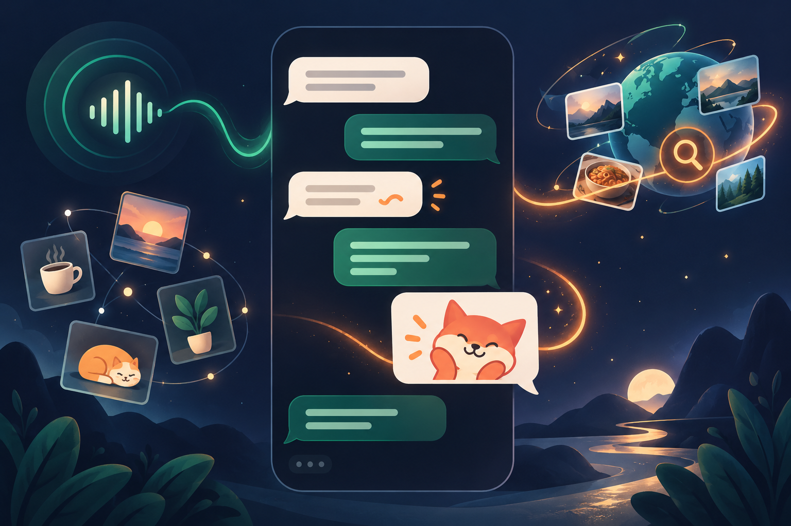

# Guiding Partner

<div align="center">
  <p><strong>运行在 DeepSeek Harness 里的本地优先 AI 陪伴插件</strong></p>
  <p>通过微信或 QQ 聊天，会倾听、会接梗、能记住偏好，也能主动来找你。</p>
  <p>
    <a href="LICENSE"></a>
    
    
    
  </p>
</div>

<p align="center">
  
</p>

Guiding Partner 是一个给自己长期使用的引导型 AI 陪伴插件。它把微信或 QQ 接入本机 DeepSeek Harness，在平等、有边界的关系里倾听和接话，而不是把每次聊天都变成客服问答或心理咨询报告。

它基于 [xmanrui/dsh-im](https://github.com/xmanrui/dsh-im) 的 IM 接入能力继续开发；原项目采用 MIT License，本仓库保留相应许可证和第三方声明。

## 能做什么

- 默认使用短句和 1–3 个聊天气泡，避免一次回复一整篇。
- 根据聊天提炼可遗忘、可暂停的长期偏好与近期关注点。
- 支持早晚安、兴趣话题和有边界的主动联系；长期不回复会逐渐安静。
- 能接梗、吐槽和调用幽默 skill，但认真倾诉时不会强行搞笑。
- 能主动联网查资料，同时避免把姓名、地址和原始私聊提交给搜索服务。
- 能按语义选择表情包，也能把你发送的图片加入本地表情包库。
- 微信与 QQ 支持图片输入；能否识图取决于当前模型是否支持图片。
- 可以看到并调用当前 companion preset 暴露的其他 Harness 工具与 skill。

<p align="center">
  
</p>

所有长期记忆、关系状态和表情包默认保存在本机 `${DSH_HOME:-~/.dsh}`，不会随 Git 仓库上传。它是陪伴工具，不假装真人，也不应用来替代专业医疗或心理危机支持。

## 本地安装

当前版本采用 GitHub 源码安装，不需要 npm 发布包。

### 准备环境

- 已安装并能运行 DeepSeek Harness；
- Node.js `>= 22.19`；
- Git 与 npm；
- 一个可用于文字聊天的模型；若要识图，还需选择支持图片输入的模型。

### 1. 下载并构建

Windows PowerShell：

```powershell
git clone https://github.com/lsx-buu/Guiding-partner.git
Set-Location .\Guiding-partner
npm.cmd install
npm.cmd run build
```

如果 PowerShell 禁止执行 `npm.ps1`，继续使用 `npm.cmd` 即可，不需要修改系统执行策略。

macOS / Linux：

```sh
git clone https://github.com/lsx-buu/Guiding-partner.git
cd Guiding-partner
npm install
npm run build
```

### 2. 安装两个本地插件

在仓库根目录执行，并把示例路径换成实际的绝对路径。

这一步会在 `web` profile 中用当前仓库版本替换同名的官方 `@xmanrui/dsh-im`；机器人凭据仍保存在本机 `.dsh`，但建议先备份 profile 配置。

Windows：

```powershell
dsh plugin --profile web add --save-exact "C:\path\to\Guiding-partner"
dsh plugin --profile web add --save-exact "C:\path\to\Guiding-partner\packages\dsh-companion"
```

macOS / Linux：

```sh
dsh plugin --profile web add --save-exact "$(pwd)"
dsh plugin --profile web add --save-exact "$(pwd)/packages/dsh-companion"
```

若你从 DeepSeek Harness 源码仓库运行，可以把 `dsh` 换成该仓库中的 `pnpm dsh`。

### 3. 添加 companion 配置

打开 Web profile 的配置文件：

```text
Windows: %USERPROFILE%\.dsh\profiles\web\cordis.patch.yml
macOS / Linux: ~/.dsh/profiles/web/cordis.patch.yml
```

把 [`examples/companion.cordis.patch.yml`](examples/companion.cordis.patch.yml) 中的两段配置合并进去，并把 `C:/Users/YOU` 换成自己的绝对用户目录。

不要直接覆盖已有配置，尤其是已经绑定过机器人的电脑。Cordis patch 中同一个 `id` 应只保留一行；已有 `xmanrui-dsh-im` 配置时，应把 `companionHarness`、`weixin` 和 `qq` 字段合并到原有 `config`。

### 4. 启动并绑定微信或 QQ

```powershell
dsh web
```

1. 打开 Harness 的「设置 → 插件 → IM机器人」。
2. 在微信或 QQ 页面扫码绑定机器人。
3. 为机器人选择 `companion` Agent Preset。
4. 如果该聊天已经存在旧会话，发送 `/new`，再发送一条普通消息。
5. 首次私聊会建立只属于当前所有者的可信主动发送路由。

建议先测试：

```text
你是谁？
我今天工作效率属于电脑开机了，我没开机。
来个短一点的段子逗我一下。
```

## 模型与图片

文字聊天模型不一定支持图片。发送图片前，请在 Harness 或聊天命令中选择一个明确支持图像输入的模型：

```text
/models
/model <序号>
```

如果模型只支持文字，插件会拒绝把图片发给它，而不是假装看懂。OpenAI 兼容服务还需要正确配置其 Chat Completions 或 Responses 路由；具体字段以你的模型服务商为准。

## 表情包

最简单的导入方式是在微信或 QQ 私聊中发送 `/bqb`，连续发送图片，最后发送 `/bqb_end`。

图片和标签只写入本机 `.dsh` 数据目录。目录导入、去重、冷却时间和控制命令见 [`packages/dsh-companion/README.md`](packages/dsh-companion/README.md)。请只使用自己拥有或获准使用的素材，不要把个人或网络采集的表情包目录提交到公开仓库。

## 常用聊天命令

| 命令 | 用途 |
| --- | --- |
| `/help` | 查看机器人支持的全部命令 |
| `/new` | 解除当前会话绑定，让下一条消息创建新会话 |
| `/status` | 检查机器人与 Harness 的连接 |
| `/models` | 列出可用模型 |
| `/model <序号>` | 切换当前聊天模型 |
| `/presetlist` | 列出 Agent Preset |
| `/preset <序号>` | 为后续新会话选择 Preset |
| `/compact` | 压缩较早的上下文 |
| `/stop` | 停止当前正在运行的任务 |
| `/bqb` / `/bqb_end` | 开始 / 结束表情包采集 |

## 更新

```powershell
git pull
npm.cmd install
npm.cmd run build
```

更新后重新执行两个 `dsh plugin ... add --save-exact` 命令，然后重启 `dsh web`。本地 `.dsh` 中的机器人凭据、记忆数据库和表情包不会被仓库更新覆盖。

## 隐私与安全边界

- Secret、Token 和扫码凭据只应提交给本机 Harness Host，不要写进仓库。
- 主动消息只允许发送到精确验证过的微信或 QQ 所有者私聊路由。
- 长期记忆可以暂停、遗忘或清空；原始聊天不会直接复制进 companion 数据库。
- 外发、删除、购买和发布等有副作用的工具动作仍需用户明确同意。
- 网络搜索只应使用完成任务所需的抽象主题。

## 开发与验证

```powershell
npm.cmd test
npm.cmd run build
npm.cmd --workspace packages/dsh-companion test
```

项目结构：

```text
plugin-src/                  dsh-im 的客户端与 Host 插件
src/channels/                微信、QQ 等渠道适配与 Harness 桥接
packages/dsh-companion/      陪伴人格、记忆、调度、表情包与 skill
examples/                    本地 Cordis 配置示例
docs/                        设计、进展与图片
```

## License 与致谢

本项目以 MIT License 开源。IM 接入部分基于 [xmanrui/dsh-im](https://github.com/xmanrui/dsh-im)；请同时阅读 [`LICENSE`](LICENSE) 与 [`THIRD_PARTY_NOTICES.md`](THIRD_PARTY_NOTICES.md)。

README 中两张概念配图由 OpenAI 图像生成工具制作，仅用于说明产品体验，不是微信、QQ 或 DeepSeek Harness 的真实界面截图。
